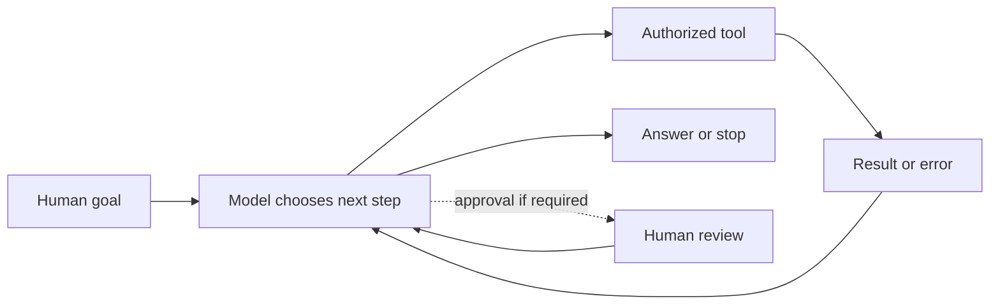
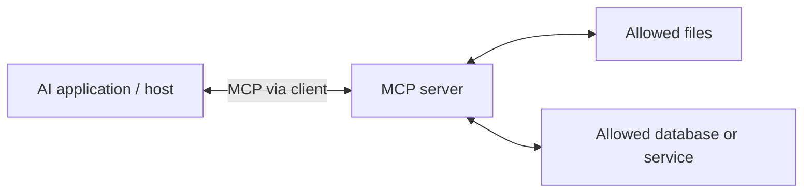
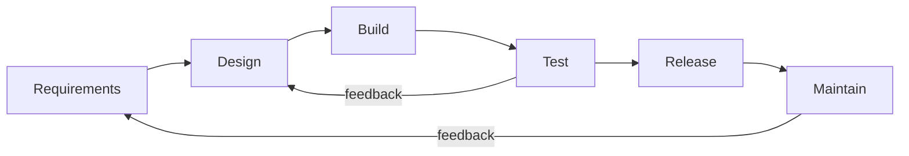
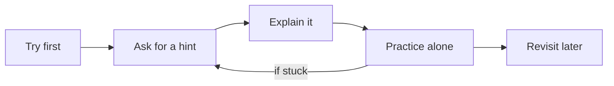

# AI Unfiltered — Presentation master & speaker handoff

**Working title (not approved):** AI Unfiltered: From predicting words to changing how we work  
**Presenters:** Omar (chapters 1–3) and Ezzat (chapters 4–5)  
**Audience:** university students, assumed mixed AI experience  
**Version:** 1.0 — proposed slide content for review, 25 November 2026  
**Format:** entertaining, conversational, offline-first; not a technical workshop.  
**Venue constraint:** underground hall, no internet. Audience connects to the local router at the entrance. All essential presentation material and activities must work without cloud APIs.

> **Scope:** This is the presentation content master to use when creating the decks in the event website. It is not a website implementation or a final network design. Only the two explicitly agreed activities are scheduled: **You Are the LLM** and **30-minute open debate**. Other activities discussed earlier, including live coding, AI on Trial, Hallucination Olympics and audience coding competitions, remain unapproved and are not included. The funny examples and dialogue below are speaker material, not additional games. Exact title, total duration, audience size and detailed motion wording are still open.

## 1. Creative direction

The audience should feel as though they are attending a conversation about their lives and their future, not another university lecture. Teach concepts only after introducing a relatable situation. The shared narrative: a model that generates words becomes part of a system capable of doing work; that changes what developers do, what students should learn and what decisions humans must still own.

| Chapter | Owner | Emotional goal | One thing to remember | Proposed time |
|---|---|---|---|---:|
| 01 — Opening | Omar | Make them laugh | Fluency does not guarantee truth | 10 min |
| 02 — Agentic AI | Omar | Make them curious | Models become more useful when given context, tools and a controlled workflow | 20 min |
| 03 — Software engineering | Omar | Make them question current practices | Faster generation is not necessarily better engineering | 20 min |
| 04 — Learning | Ezzat | Make them reflect on habits | Use AI to build capability, not merely complete work | 20 min |
| 05 — Debate | Ezzat; Omar supports | Make them challenge us and each other | There are real tradeoffs, not one correct attitude to AI | 30 min |
| Transitions and close | Both | Leave with actionable ideas | Ask, check, own | 5 min |
| **Total** | | | | **105 min** |

Timing is a planning assumption, not an agreed event length. If 120 minutes are available, retain 15 minutes as setup/transition buffer, rather than adding more slides. If shorter, cut examples in chapters 2–4 and preserve the 30-minute debate. Wi-Fi onboarding occurs before the opening; do not assume every attendee connects successfully.

### Tone and visual direction

- One idea per slide; big titles, one illustration or a few short lines. Avoid definitions before the audience knows why they matter.
- Use the presenters' own conversational style. Humor comes from recognizable university situations, not insulting students or performing forced sketches. Arabic/Egyptian conversational delivery is optional; slide text is English.
- Keep the exact technical explanation in speaker notes. A slide should not be a textbook paragraph.
- Use original mockups for example AI chats, captions identifying them as fictional, and simple presenter-created diagrams. No unsupported meme attribution or borrowed charts.
- Avoid claims that all students cheat, that all AI users are dependent, that all jobs will disappear, or that current AI always increases/decreases productivity.
- During rehearsal, strip anything that needs a long definition. Aim to spend no more than a few minutes on an individual technical term.

### Shared running example

A fictional CS student called Karim receives a group assignment, uses an AI assistant to organize it, then builds a campus event website. The assistant can draft, use tools, generate code and explain concepts, but the student must decide, verify and retain responsibility. This is an original fictional scenario; it is not a documented case study or observed output. Omar and Ezzat can refer back to Karim instead of inventing new contexts for every slide.

### Slide authoring convention

Each slide below has a unique ID, owner, proposed time, screen copy, presenter notes, visual direction and source references where relevant. Only content in **On screen** is intended to be projected by default. Sources can sit in a small footer or in an accessible references panel; speaker notes are private. All examples are original and illustrative unless explicitly labeled otherwise.

---

# Chapter 01 — Opening: AI without the lecture

**Owner:** Omar • **Goal:** Make them laugh • **Budget:** 10 minutes • **Slides:** O01–O05

## O01 — The most confident person in the room | 1 min

**On screen:**

> “The code works.”  
> “Do you understand it?”  
> “The code works.”

**Presenter notes:** Open with the fictional exchange, then welcome everyone. Say: “Today is not a machine learning lecture. We're going to look at why AI is useful, why it sometimes makes ridiculous mistakes, and what that means for us.” Ask Ezzat to deliver the second line if natural. Do not add an unapproved poll.

**Visual:** Huge chat bubbles, contrasting colors; fictional dialogue label in footer. No external image needed.

## O02 — You Are the LLM | 5 min | Confirmed live activity

**On screen:** Predict what comes next. No looking at your friends' answers.

**Activity:** Project each sentence; audience selects one answer on the local website. Use live results to introduce uncertainty and context. Detailed activity specification is in Appendix A. The choices are words or phrases for simplicity, not actual tokenizer outputs.

**Presenter notes:** Start quickly and react naturally to the real votes. Do not script the outcome or pretend votes are model probabilities. After round 3, explain: “You've all seen the same incomplete sentence, but your expectations differ. A language model produces a distribution over possible next tokens based on its input. We are only acting out the idea, not reproducing its mathematics.” [S1]

**Visual:** Large sentence on projector, answer tiles on mobile, horizontal bars after presenter reveals results. Live audience results; no fabricated statistics.

## O03 — It starts with a prediction | 2 min

**On screen:**

- AI is a broad field; language models are one type of AI.
- Many modern LLMs generate text one token at a time.
- A token can be a whole word, part of a word or punctuation.

**Presenter notes:** Connect to the activity rather than introducing ML taxonomies. A model learns patterns from training data; at generation time its existing context guides the next output. Text generation is not equivalent to searching for a verified fact. Some deployed assistants use additional training, tools and other techniques; do not reduce the whole system to phone autocomplete. [S1, S2]

**Visual (original illustrative diagram):** `Input context → Next-token distribution → Selected token → Updated context ↺`. The repeated loop depicts autoregressive text generation at a high level; no numeric probabilities shown. Conceptual source: [S1].

## O04 — Confident ≠ correct | 1 min

**On screen:** “Please cite three papers proving that attendance at 8 AM improves Wi-Fi speed.”  
**Below:** A confident-looking citation is not a verified citation.

**Presenter notes:** This is a deliberately absurd fictional request, not a reported hallucination. An AI might refuse, correct the premise or produce an unsupported response. Define hallucination as fabricated or unsupported content, and explain that a fluent answer may still require verification. Ask students to open and check the original reference when researching outside the event. [S2]

**Visual:** An original fake citation card marked “ILLUSTRATIVE — NOT A REAL PAPER.” Never present a fabricated reference as real.

## O05 — What if it could do more than talk? | 1 min

**On screen:** A chatbot answers. A tool-enabled assistant can act.

**Presenter notes:** “Imagine instead of telling you how to organize your assignment, the system could inspect the files, prepare a plan and check the result. Would you give it access to everything?” Do not explain MCP yet. Transition directly to chapter 2. [S3]

---

# Chapter 02 — Agentic AI: From conversation to action

**Owner:** Omar • **Goal:** Make them curious • **Budget:** 20 minutes • **Slides:** A01–A07

## A01 — Same student, bigger request | 2 min

**On screen:** “My deadline is tomorrow. Help me survive.”

**Presenter notes:** Introduce Karim, the fictional CS student. A plain chat model can give suggestions based on what he tells it. A more capable assistant can use provided lecture files and tools to help prepare a plan. Distinguish between an answer and actually performing an authorized action. This is an illustrative scenario, not an actual product run. [S3]

**Visual:** Two side-by-side original chat cards: `Here is a plan` versus `I inspected the files, drafted a plan, and need approval before changing anything`.

## A02 — What makes an agent? | 3 min

**On screen:** The result of one action informs the next.

**Presenter notes:** An agentic system uses a model and tools to make decisions over multiple steps, observe results and continue when appropriate. Not every assistant is autonomous; a fixed workflow can be simpler and more reliable than a highly autonomous agent. Give the example of a coding assistant running a test, reading the error and revising the code. “An agent that never checks its work is a very expensive way of guessing.” [S3]

**Visual — original conceptual diagram, adapted from the agent/workflow distinction in [S3]:**



**Rendering fallback:** `Human goal → model → authorized tool → result → model → stop/review`. Mermaid must be pre-rendered or bundled locally. Do not show raw code to the audience.

## A03 — Context: the AI has not attended your lectures | 3 min

**On screen:** “Explain chapter 5.”  
Which course? Which textbook? Which exam? What do you already know?

**Presenter notes:** The context window is the amount of tokenized information the model can process in a given invocation, subject to the system's limits. Context engineering means making the relevant instructions, materials and task state available when needed. A saved memory or retrieval system is separate from the context window; it can retrieve selected information into context. More text is not automatically better. Karim should provide the syllabus and relevant examples, not a giant unrelated folder. [S3, S4]

**Visual:** Two original prompt cards (vague vs. grounded); no need for exact token limits or vendor comparison.

## A04 — MCP: how AI connects to things | 3 min

**On screen:** MCP lets an AI application discover and use tools it has access to.

**Presenter notes:** MCP stands for Model Context Protocol. It is an open standard that helps AI applications connect to external capabilities and data. A tool might read a local file or list a calendar event; an MCP server exposes capabilities that an MCP-compatible host can use. MCP is neither a model nor a guarantee of safety or autonomy. The familiar USB-C analogy is useful but imperfect; it is a protocol, not an actual cable. [S5]

**Visual — original simplified diagram informed by official MCP documentation [S5]:**



**Fallback text:** `AI application + MCP client ⇄ MCP server ⇄ authorized resources/tools`. This is a logical illustration, not a deployment diagram. Some tools use other interfaces rather than MCP. Local servers can run offline; servers backed by remote services cannot be assumed to work in this hall.

## A05 — Skills: stop repeating the same instructions | 3 min

**On screen:** MCP gives access. A skill describes a way to work.

**Presenter notes:** A reusable skill can package instructions, examples, templates and optional scripts for a particular task. In the Agent Skills format, a folder contains a SKILL.md file and may include other resources. For example, Karim can specify a preferred study-note layout: definitions, examples, mistakes, practice questions, and answer key. This is not model retraining. A skill needs review and may still be followed imperfectly. [S6]

**Visual:** Two fictional cards. `Tool: read lecture.pdf` and `Skill: turn a lecture into a revision guide, verify against source, then create practice questions`.

**Speaker-only optional technical example (not a separate activity):**

```text
lecture-revision/
  SKILL.md
  examples/
    revision-template.md
```

## A06 — Give it a key, not the whole building | 3 min

**On screen:** Read files? ✓  • Draft changes? ✓  • Delete the whole project? Not without permission.

**Presenter notes:** Access, permissions and review matter. Least privilege means granting only the capabilities required. Treat instructions found inside untrusted content as data rather than automatically obeying them; agents may be vulnerable to prompt injection. Restrict tools and require human approval for consequential actions. For Karim, reading lecture notes is lower risk than changing files or sending messages on his behalf. No real attack or account action is demonstrated. [S7]

**Visual:** Three doors labeled read, edit, irreversible; last one locked. Original analogy.

## A07 — All of that, without internet? | 3 min

**On screen:** Internet ≠ Wi-Fi ≠ AI.  
Local model • Local files • Local tools

**Presenter notes:** Our audience is connected to a local website even though the hall has no internet. This illustrates the difference between local networking and internet connectivity. AI systems can also run locally if models and dependencies are present and hardware is sufficient; online services are unavailable here. Do not promise a live local model demonstration or claim this event website contains AI. The website is the networking example. If showing a prepared screenshot of an AI tool, label it “recorded/prepared before event.” [S8]

**Visual — original conceptual diagram:** `Audience phone ⇄ local router ⇄ laptop website` (no WAN). A separate label: “Local AI is a different component, not required for this website.” Source: event design decisions; no externally copied diagram.

**Transition:** “Now imagine we apply these capabilities to software projects. Generating code is only one part of the work.”

---

# Chapter 03 — Software engineering after AI

**Owner:** Omar • **Goal:** Make them question current practices • **Budget:** 20 minutes • **Slides:** S01–S07

## S01 — It works on my ChatGPT | 2 min

**On screen:** `Generated ✓` `Looks good ✓` `Tested ?` `Understood ?`

**Presenter notes:** Return to the opening joke. Karim builds a campus events website with an AI assistant. The landing page looks polished, but the organizer asks whether voting works, whether users can access presenter-only content and whether the site survives a disconnect. The visible result is not the entire product. This is fictional and deliberately simplified.

**Visual:** Original mock dashboard with a glossy “Launch” button and a small “tests pending” marker. No claim about any real AI-generated product.

## S02 — AI didn't delete the SDLC | 4 min

**On screen:** Understand → Design → Build → Test → Release → Maintain

**Presenter notes:** Explain SDLC (software development lifecycle) in one sentence: the work required to turn a need into a maintained software system. AI can help at every stage, but the team still has to validate outcomes. Traditional iterative/Agile processes already used feedback; AI can change the speed and allocation of tasks, not invent iteration. [S9]

**Visual — original teaching table, not a measurement:**

| Stage | AI could help with | Human/team still owns |
|---|---|---|
| Requirements | Clarifying questions, initial spec | Actual user needs and scope |
| Design | Alternatives and prototype | Architecture and tradeoffs |
| Implementation | Code drafts and refactors | Correctness and integration |
| Testing | Candidate tests and debugging | Coverage, expected behavior, review |
| Release | Deployment instructions | Approval, monitoring and rollback |
| Maintenance | Triage and documentation | Priorities and safe changes |

**Diagram (original, informed by [S9]):**



Add a visual ribbon above: “AI can assist throughout; accountable people remain involved.” No quantitative claim implied.

## S03 — Vibe coding or engineering? | 3 min

**On screen:** “Build me a voting website.”  
vs.  
“Build a voting website where one attendee can cast one vote per round; only presenters can open a poll.”

**Presenter notes:** Use vibe coding as the informal style of relying on generated changes and judging mainly by visible output. Not every natural-language coding workflow fits this label. Show how specifying behavior creates something testable. Vibe coding can be useful for prototypes; the risk rises when code moves into production without understanding or review. Do not stage an unapproved coding competition. [S9, S10]

**Visual:** Original side-by-side prompt cards; the improved prompt is still incomplete and is not a complete requirements spec.

## S04 — What can go wrong? | 3 min

**On screen:** “What if I vote twice?” “What if the Wi-Fi drops?” “What if an attendee opens the presenter screen?”

**Presenter notes:** These questions are directly relevant to the local event website. Requirements are not only features; they include permissions, error handling and constraints. Define technical debt as a tradeoff in design or implementation that creates future work. Avoid claiming that AI automatically creates debt. Fast prototypes may be great if their limits are explicit. [S7, S9, S10]

**Visual:** Original checklist: reject duplicates according to policy; reconnect and restore the active round; enforce permissions on server; verify local-only deployment. These are illustrative acceptance criteria, not assertions that the event platform already supports them.

## S05 — A code example that looks right | 3 min

**On screen:** Fictional vote counter; find what is missing (presenter explains; no separate competition).

```python
votes = {"A": 0, "B": 0}

def vote(choice):
    votes[choice] += 1
```

**Presenter notes:** This tiny example increments valid keys but has no identity, open/closed state, duplicate-vote rule or invalid-choice handling. It also says nothing about persistence or concurrent submissions. Do not claim this is AI output: it is an original teaching example. Walk through `vote("A")` twice; if one vote per round is required, the implementation cannot enforce it. A passing happy-path example is not a robust system. The lesson: define behavior, review code, and test failure cases. [S10]

**Visual:** Code on left, three small test cases on right. Avoid live execution; slides contain results as authored examples. The shown snippet is deliberately incomplete, not production guidance.

## S06 — Does AI save coding time? | 3 min

**On screen:**

| Experiment | Task | Time with AI |
|---|---|---|
| Peng et al. (2023) [S15] | Build one JavaScript HTTP server | **55.8% less** |
| METR (2025) [S11] | 246 tasks in familiar open-source repositories | **19% more** |

**Presenter notes:** Ask what you would time on Hall Live: the first working screen, or the change after review and testing? Peng et al. recruited 95 freelance developers and randomized Copilot access for one task. The paper reports the time difference for completed tasks. METR randomized AI availability across real tasks from 16 experienced open-source developers in early 2025. The tools, participants and tasks differed, and the studies cannot isolate which difference accounts for the results. METR's February 2026 update describes selection and measurement problems in its follow-up [S12]. DORA examines organization-level practices [S9]. Measure time through review, testing and rework on your own task.

## S07 — The developer still owns the result | 2 min

**On screen:** Specify it. Review it. Test it. Own it.

**Presenter notes:** Give four habits: describe the outcome and constraints, inspect generated changes, check behavior independently, and remain responsible for deploying or submitting the result. The most important skills are not just prompting; they include problem decomposition, reading code, debugging, reasoning about systems, communication and security awareness. These are recommendations, not forecasts of hiring patterns. [S9, S10]

**Transition:** Use the same test on your coursework. Could you explain the result and solve a similar problem tomorrow?

---

# Chapter 04 — Learning without outsourcing your thinking

**Owner:** Ezzat • **Goal:** Make them reflect • **Budget:** 20 minutes • **Slides:** L01–L06

## L01 — The assignment is finished. Are you? | 3 min

**On screen:** Deadline met ✓ • Topic mastered ?

**Presenter notes:** Begin with Karim submitting a working assignment, then being unable to explain a small change asked by a professor. Present this as a fictional relatable situation, not a claim about audience behavior. Avoid shaming students. Using AI can be valuable, but the objective of learning differs from completing a deliverable.

**Visual:** Two original progress bars with no percentages: “Assignment progress” and “Independent understanding.” These are metaphors, not measured data.

## L02 — Two ways to ask for help | 3 min

**On screen:**

| Answer-machine prompt | Tutor prompt |
|---|---|
| Solve this for me. | Ask me what I tried, then give one hint. |
| Write the entire solution. | Help me explain my approach and test it. |

**Presenter notes:** Both approaches can be appropriate depending on whether the goal is producing an artifact or learning. For learning, support should gradually fade and the learner should demonstrate understanding. AI can make errors even as a tutor. [S13, S14]

**Visual:** Original side-by-side fictional dialogue cards. Not an additional audience experiment.

## L03 — An example: a loop is not magic | 4 min

**On screen:** What does this return for `[3, 8, 2, 9]`?

```python
def count_large(values):
    count = 0
    for value in values:
        if value > 5:
            count += 1
    return count
```

**Presenter notes:** Walk through a fictional AI tutoring conversation. Student asks what `count` does. Tutor says “Track it after each value; what happens when value is 8?” Show the trace `0 → 0 → 1 → 1 → 2`; final answer 2. Then contrast with an explanation that merely states the answer. Explain transfer by discussing a new list `[6, 5, 1, 10]` and changing the condition to `>= 5`. Answers: original condition gives 2; changed condition gives 3. This is a prepared explanatory example, not a timed or voted activity.

**Visual:** One highlighted line at a time; trace appears on next reveal. Code and examples are original.

## L04 — Can you do it without AI? | 4 min

**On screen:**

| Study | Setting | Finding |
|---|---|---|
| Bastani et al. (2025) [S13] | High-school math with unrestricted chat | Better practice scores, worse exam scores without AI |
| Kestin et al. (2025) [S16] | Structured tutor in college physics | Higher immediate post-test scores than active learning in class |
| Shen & Tamkin (2026) [S17] | Learning a Python library | Quiz average **50% with AI vs. 67% without** |

**Presenter notes:** Bastani et al. randomized classes in one high-school math setting. The guided tutor largely mitigated the downside of unrestricted chat, with no clear exam gain over the control. Kestin et al. evaluated a custom tutor across two lessons in one introductory physics course. The immediate post-test leaves long-term retention open. Shen and Tamkin randomized AI access for 52 developers learning Trio. The quiz difference was statistically significant, while the overall task-time difference was not. Ask students to try a fresh problem without AI and explain their reasoning. The broader learning review supports practice testing and spacing [S14].

## L05 — A better AI study routine | 4 min

**On screen:** Finish by solving a fresh problem on your own.

**Presenter notes:** Describe how students can use a tutor: attempt a problem first; identify what is confusing; ask for a small hint; explain the answer back; solve a new problem without AI; repeat later. Practice testing and distributing study over time support retention [S14]. The exact five-step sequence is our proposed practical synthesis, not a validated named intervention. If the AI makes factual claims, check course materials and reliable references.

**Visual — original teaching diagram informed by [S13, S14]:**



**Take-home prompt:** “Act as a tutor. Ask what I've attempted. Give me one hint at a time, wait for my reasoning, correct my mistakes, and finish with a similar problem I must solve without help. If you aren't sure, say so.” Original suggested prompt; verify the output.

## L06 — Learn the things AI cannot learn for you | 2 min

**On screen:** Understanding • Judgment • Practice • Accountability

**Presenter notes:** Recommend protecting fundamentals: read and trace code, learn algorithms and data structures, understand system behavior, debug, explain decisions, and practice without assistance when needed. Respect university/course policies about permitted AI use. Avoid labeling habitual AI use as a medical addiction; discuss dependence as behavior and loss of independent practice as a risk.

**Transition:** “We can disagree about how far AI should go. That's why the next part belongs to everyone in the room.”

---

# Chapter 05 — The uncomfortable questions

**Owner and moderator:** Ezzat • **Omar:** co-presenter / opposing argument when appropriate • **Duration:** 30 minutes fixed • **Slides:** D01–D05

The open debate is a confirmed activity. The three motions below are proposed choices from the topics already discussed; exact wording can be changed by the presenters. Do not treat audience preferences as representative of all students or as proof of future outcomes.

## D01 — You get to disagree with us | 2 min

**On screen:** Vote. Explain. Listen. Vote again.

**Presenter notes:** Establish rules: debate claims rather than people; keep contributions short; encourage different views; no pressure to vote; anonymous ballots; no personal attacks or academic confessions. Explain that changing one's mind is acceptable. Both presenters may acknowledge valid points on either side. The moderator does not announce a predetermined winner.

## D02 — Motion 1: Should first-year students learn programming without AI? | 8 min

**On screen:** “First-year programming students should learn the fundamentals without AI-generated solutions.”

**Arguments supporting:** Independent practice can reveal misunderstandings; instructors need to assess individual competence; relying on generated answers may reduce opportunities to build foundational skills. [S13, S14]

**Arguments challenging:** Guided hints and feedback can improve access to assistance; rigid prohibitions may prevent useful tutoring and accessibility support; professional environments increasingly include AI tools.

**Moderator prompts:** “Is the problem AI itself or how it is used? Would you allow hints but prohibit final answers? Would the same rule apply during exams and during study?”

**Nuance:** Distinguish AI tutoring, code generation, accessibility tools and exam rules. Evidence from math classrooms is informative but not decisive for programming courses.

## D03 — Motion 2: Will junior software engineers become less necessary? | 8 min

**On screen:** “AI will reduce the need for junior software engineers.”

**Arguments supporting:** Some entry-level tasks can be assisted or automated; teams may reorganize work and expect broader skills; repetitive coding may require less human time.

**Arguments challenging:** Junior developers do more than type code; teams need to develop future experienced engineers; new products and tasks may appear, and productivity effects are context-dependent. [S9, S11, S12]

**Moderator prompts:** “What would you expect from a new graduate today? If companies stop developing juniors, where will future seniors come from? Does more software create demand for more engineers?”

**Nuance:** Do not present a numerical employment forecast; these are competing hypotheses. The cited productivity studies do not measure employment or establish future job displacement.

## D04 — Motion 3: Should you deploy code you cannot explain? | 8 min

**On screen:** “Developers should never deploy AI-generated code they cannot explain.”

**Arguments supporting:** Review and understanding support maintenance, debugging, accountability and security; the developer needs evidence the system meets requirements. [S7, S10]

**Arguments challenging:** Engineers already use abstractions and libraries whose internals they do not fully know; independent tests, documentation and team review can support justified trust; the required level of explanation depends on impact.

**Moderator prompts:** “Explain every line or explain system behavior? What changes for financial software versus a personal prototype? Who is accountable if an AI-generated feature fails?”

**Nuance:** This deliberately strong statement is a debate motion, not a blanket engineering rule. Distinguish understanding an interface and its assumptions from understanding every internal implementation detail.

## D05 — What changed your mind? | 4 min

**On screen:** “What will you do differently after today?”

**Presenter notes:** Read the aggregate before/after results of the three motions. Ask for two or three short final perspectives. Explain that vote shifts can show changed opinions in this room, not establish what is true. Conclude with a practical habit each presenter personally commits to. This reflection is part of the debate, not an additional separately timed activity.

**Closing line:** “Use AI to become more capable, not merely to look more capable.” Original presenter wording.

---

# Closing slide C01 — Ask better. Check better. Own the result. | 5 min including transitions

**On screen:**

1. AI can generate convincing answers; verify important ones.
2. Tools and agents expand capability; control permissions.
3. Engineering is more than generating code.
4. Measure learning by what you can do independently.
5. Stay curious and willing to disagree.

**Presenter notes:** Thank the audience. Display an offline references page or a short link to local resources only if already available. Do not add a mandatory exit poll or new activity. Both presenters share the closing. The event does not require cloud AI to be meaningful.

---
# Appendix A — Confirmed activity: You Are the LLM

**Activity ID:** act-predict • **Owner:** Omar • **Linked slide:** O02 • **Time:** 5 minutes. All questions and options are proposed original examples for the approved activity; presenters can edit them.

| Round | Screen prompt | Choices | Teaching point |
|---|---|---|---|
| 1 | The professor said the quiz would be very… | easy / short / fair / unexpected | Context gives several plausible continuations. |
| 2 | At 11:59 PM, the CS student finally opened… | the assignment / the IDE / the group chat / ChatGPT | Relatable ambiguity and audience humor. |
| 3 | The program crashed, so the developer opened the error… | log / message / report / screen | Added technical context can narrow the likely continuation. |

**Run of show:** 0:00–0:30 explain the rule; 0:30–1:30 round 1; 1:30–2:30 round 2; 2:30–3:30 round 3; 3:30–5:00 connect results to next-token prediction. In each round: open voting, give approximately 15 seconds, close voting, reveal aggregate results, comment briefly. Do not mark one answer correct; this is a prediction activity. The full sentences are fictional prompts and the response choices are simplified continuations, not model token IDs.

**Audience screen:** prompt, four selectable choices, submit/confirmation and waiting state. **Projector:** prompt and choices during vote; real aggregate count and percentages after close. **Presenter:** open, close, reveal, advance and reset in rehearsal. Use separate IDs `predict-01`, `predict-02`, `predict-03`.

**Results:** show actual vote count per choice and percentage of valid ballots cast in that round, not percentage of all people in the hall. If there are zero votes, show “No votes received.” No preloaded fake results or suggested majority. A chart created from live responses is sourced to this event's anonymous ballots, date and round ID. It is not an empirical distribution from an LLM.

**Fallback:** ask for a show of hands or call out choices. If there are not enough responses, discuss the alternatives without percentages. Continue with the next-token diagram regardless of Wi-Fi performance.

# Appendix B — Confirmed activity: 30-minute open debate

**Activity ID:** act-debate • **Owner:** Ezzat • **Linked slides:** D01–D05 • **Duration:** 30 minutes.

For each of the three proposed motions, use this eight-minute cycle:

| Elapsed within motion | Action |
|---|---|
| 0:00–0:30 | Read the motion neutrally and open the first ballot. |
| 0:30–1:00 | Close and reveal the initial aggregate results. |
| 1:00–2:30 | Present a short argument on each side (45 seconds each). |
| 2:30–6:30 | Invite audience arguments and questions, share microphone fairly. |
| 6:30–7:00 | Open and close the second ballot. |
| 7:00–8:00 | Reveal both distributions and summarize the tradeoff. |

Before the motions: 2-minute introduction. After them: 4-minute closing discussion. Total = 2 + 3×8 + 4 = 30 minutes.

**Ballot choices:** strongly agree / agree / unsure / disagree / strongly disagree. Abstention is permitted by not voting. Use one ballot per attendee per round according to the platform's session policy. Record pre and post rounds separately, not overwriting the first ballot. IDs: `debate-01-pre`, `debate-01-post`, `debate-02-pre`, `debate-02-post`, `debate-03-pre`, `debate-03-post`.

**Result visualization:** side-by-side horizontal stacked bars using each round's valid-voter denominator; include response counts and labels. If participation differs between rounds, say so. Do not claim individual opinion changes from unmatched aggregate totals. No real chart exists before the event; live data are the source, and the design is original. Do not add fabricated numbers to the slides.

**Moderation:** prevent personal accusations, sensitive disclosures and identification of students who may have used AI for assignments; no recording of names in ballots. Avoid forcing participants to defend a position they do not hold. If time slips, shorten debate exchanges evenly rather than rushing closing. If the audience is quiet, both presenters provide contrasting arguments and invite one response from each side. If local voting fails, use anonymous paper ballots if available or a voluntary show of hands; avoid percentages if counts are uncertain.

# Appendix C — Handoff to the presentation studio

This appendix specifies content needs for the existing website work, not a full platform design. Slides and their ownership can be implemented from this manifest. The access decisions below are proposed least-privilege defaults, not approval of a specific authentication system.

| Chapter | Owner | Slide IDs | Activity IDs |
|---|---|---|---|
| Opening | Omar | O01–O05 | act-predict |
| Agentic AI | Omar | A01–A07 | None |
| Software engineering | Omar | S01–S07 | None |
| Learning | Ezzat | L01–L06 | None |
| Debate | Ezzat | D01–D05 | act-debate |
| Closing | Both | C01 | None |

**Authoring access proposal:** Omar edits chapters 1–3, Ezzat edits chapters 4–5, both may preview all chapters; decide separately who can publish the final deck, edit shared closing content, administer accounts and change global settings. The audience sees published current activity and any intentionally shared content, never draft notes. Projector view displays only public slide material and revealed results. Explicitly coordinate the presenter handoff before chapter 4. Server-side authorization is required, not just hidden UI controls.

**Per-slide content fields (example, not a committed schema):**

```yaml
id: O02
chapter: opening
owner: omar
status: draft
title: You Are the LLM
slide_type: activity
estimated_minutes: 5
public_text: Predict what comes next.
private_speaker_notes: Reveal each round and explain the analogy.
activity_id: act-predict
sources: [S1]
media: []
```

For each slide store public copy, speaker notes, optional media and alt text, source IDs, order and draft/published state. Preserve source notes when slides are edited. Prepare a local noninteractive export as fallback. The deck must remain presentable even if audience phones disconnect. All media, diagrams, fonts and runtime dependencies must be available locally; pre-render Mermaid diagrams to SVG/PNG for a studio that cannot render them offline. No model calls are required for either activity. No external image assets or reproduced research charts are bundled in this file.

### Before both presenters publish

- Omar: review humor, technical descriptions and engineering examples; rehearse activity controls; shorten jargon.
- Ezzat: review learning examples and debate motions, prepare fair counterarguments and practice moderating without leading the audience.
- Both: agree on total duration and title, share final notes, review transition, verify that every claim is sourced and every fictional example labeled, confirm permission roles, rehearse with WAN disconnected, confirm local router capacity with expected audience and venue, and keep an independent deck fallback.

# Appendix D — Source register and content review

Research consulted on 25 November 2026. Sources support specific concepts and research findings, not the event's fictional stories or subjective timing choices. Source IDs appearing in speaker notes should be retained in the website deck. Use dated wording for studies, and do not imply these are the newest available results or universal causal findings. All diagrams in the document are original simplified drawings with conceptual attribution; there are no third-party chart images reproduced. The vote graphs will be generated from actual live data only.

| ID | Source and direct link | Use and scope |
|---|---|---|
| S1 | OpenAI, GPT-4 Technical Report (2023), [report](https://cdn.openai.com/papers/gpt-4.pdf); OpenAI, [Understanding and counting tokens](https://help.openai.com/en/articles/4936856-understanding-and-counting-tokens) | Autoregressive pretraining and token concepts; GPT-4 is an example, not a definition of every AI model. |
| S2 | OpenAI, [Why language models hallucinate](https://openai.com/index/why-language-models-hallucinate/) (2025) | Language model hallucinations and incentives; vendor research, not a claim that every answer is inaccurate. |
| S3 | Anthropic, [Building effective agents](https://www.anthropic.com/research/building-effective-agents) (2024) | Tool-augmented models, feedback, workflows vs agents; practical vendor architecture guidance. |
| S4 | Anthropic, [Effective context engineering for AI agents](https://www.anthropic.com/research/effective-context-engineering-for-ai-agents) (2025) | Context selection, retrieval and limitations. |
| S5 | Model Context Protocol, [What is MCP?](https://modelcontextprotocol.io/docs/getting-started/intro) | Official protocol introduction and conceptual architecture. |
| S6 | Agent Skills, [Agent Skills overview](https://agentskills.io/home) | Official skill format, reusable instructions and resources. |
| S7 | OWASP, [Excessive Agency](https://genai.owasp.org/llmrisk/llm062025-excessive-agency/) and [Prompt Injection Prevention Cheat Sheet](https://cheatsheetseries.owasp.org/cheatsheets/LLM_Prompt_Injection_Prevention_Cheat_Sheet.html) | Permissions, external content risks and layered protections. |
| S8 | Ollama, [Local FAQ](https://docs.ollama.com/faq) | Local inference example; hardware and predownloaded models matter. This does not verify the presenters' hardware. |
| S9 | DORA, [2025 State of AI-assisted Software Development](https://dora.dev/research/2025/dora-report/) and [Balancing AI tensions](https://dora.dev/insights/balancing-ai-tensions/) | Organizational practices, software development lifecycle and amplification; not a universal individual productivity estimate. |
| S10 | NIST, [Secure Software Development Framework (SSDF) v1.1](https://csrc.nist.gov/pubs/sp/800/218/final) (2022), [Developer verification guidance](https://www.nist.gov/itl/executive-order-14028-improving-nations-cybersecurity/software-supply-chain-security-guidance-2) | Review, testing and secure software development; general engineering guidance. |
| S11 | METR, [Measuring the Impact of Early-2025 AI on Experienced Open-Source Developer Productivity](https://metr.org/blog/2025-07-10-early-2025-ai-experienced-os-dev-study/) (July 2025); [paper](https://arxiv.org/abs/2507.09089) | 16 developers, 246 tasks, 19% longer completion time in that historical setting. |
| S12 | METR, [We are Changing our Developer Productivity Experiment Design](https://metr.org/blog/2026-02-24-uplift-update/) (February 2026) | Follow-up and sampling/measurement caveats; newer results cannot support a robust universal speedup estimate. |
| S13 | Bastani et al., [Generative AI without guardrails can harm learning: Evidence from high school mathematics](https://doi.org/10.1073/pnas.2422633122), PNAS (2025) | Field experiment, approximately 1,000 high-school math students; safeguarded tutoring versus unrestricted assistance. |
| S14 | Dunlosky et al., [Improving Students’ Learning With Effective Learning Techniques](https://doi.org/10.1177/1529100612453266) (2013) | Research review supporting practice testing and distributed practice. Not an AI-specific experiment. |
| S15 | Peng et al., [The Impact of AI on Developer Productivity](https://arxiv.org/abs/2302.06590) (2023 preprint) | Controlled Copilot experiment on one JavaScript task. |
| S16 | Kestin et al., [AI tutoring outperforms in-class active learning](https://doi.org/10.1038/s41598-025-97652-6), Scientific Reports (2025) | Structured tutor and immediate post-tests across two introductory physics lessons. |
| S17 | Shen and Tamkin, [How AI Impacts Skill Formation](https://arxiv.org/abs/2601.20245) (2026 preprint) | Randomized study of developers learning a Python library, followed by a quiz. |

### Review: what to keep, what to avoid

- Strongest opening: the original humorous exchange and approved prediction activity. Avoid technical classification diagrams or transformer internals.
- Strongest agent example: the familiar assignment scenario, one diagram for the agent loop and one for MCP. Do not turn the chapter into a list of products. No live coding or new game.
- Strongest engineering example: the audience website's own voting requirements and the incomplete vote counter. Show actual requirements, not a staged competition or claim that AI built it badly.
- Strongest learning example: how the same simple program can be explained with or without guidance. Research claims must retain the high-school mathematics caveat.
- Strongest debate: three balanced motions in 30 minutes. Do not predetermine results, claim that a vote proves a factual statement, or add a separate courtroom activity.
- Optional cuts if rehearsal feels slow: O04's fictional citation, A07's local-model explanation, S06's statistic, L04's study detail. Preserve the central lesson in each chapter and the approved activities.

### Unresolved decisions and limits

The presenters have not approved a final title, event length, detailed slide wording, debate motions, or administrator rights. The proposed timing and content are editable drafts. Audience size, network capacity, permissions and the website implementation are not yet verified. No live AI-generated answers or actual poll responses were collected in preparing this file. No live cloud services, live coding, third-party imagery, charts with fabricated data, or unapproved activities are required by this presentation.
